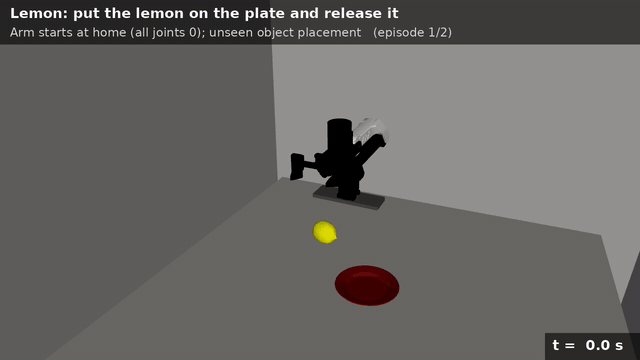
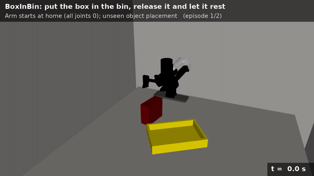
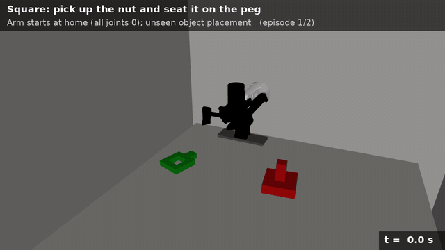
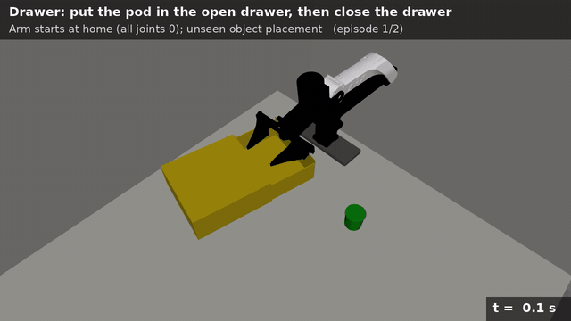

# SuperMimic for robot manipulation

This repository adapts [SuperMimic](https://arxiv.org/abs/2610.28480), policy optimization by
backpropagating the task return through a learned differentiable world model, from humanoid
motion tracking to state-based robot manipulation. Episodes start from
[OmniReset](https://arxiv.org/abs/2603.15789)-style reset distributions. Everything runs in
[mjlab](https://github.com/mujocolab/mjlab) (MuJoCo Warp) with a simulated ARX5 arm. It
contains five manipulation tasks, their reset-bank collectors, SuperMimic and a PPO baseline,
and a complete-episode evaluator.

中文说明：[README.zh-CN.md](README.zh-CN.md)

<table>
  <tr>
    <th>Lemon: put the lemon on the plate</th>
    <th>BoxInBin: put the box in the bin</th>
    <th>MugHang: hang the mug by its handle</th>
  </tr>
  <tr>
    <td></td>
    <td></td>
    <td></td>
  </tr>
  <tr>
    <th>Square: seat the nut on the peg</th>
    <th>Drawer: put the pod in the drawer and close it (2× speed)</th>
    <th></th>
  </tr>
  <tr>
    <td></td>
    <td></td>
    <td></td>
  </tr>
</table>

Each clip shows two episodes of a trained policy. The arm starts at its home pose (all joints
at zero) and the object and target come from a held-out test bank. The policy only sees
low-dimensional state; the camera is for viewing. From the home pose the Square policy
succeeds in 94% of 64 episodes and the Drawer policy in 91%; each clip shows the first two
episodes, Drawer's at 2× speed.

## Results

Every number below is native task success (the simulator's own success test, held for
0.5 s) from complete episodes with the deterministic actor. No episode was filtered.

**Held-out reset bank.** 64 episodes from each reset category, on a bank collected with a
different seed and split than the training bank. Lemon, BoxInBin and MugHang use their
checkpoints at 4,000 iterations, released on Hugging Face (below). Square and Drawer use, for
the run in the clip, the checkpoint with the best training-bank success (32 episodes per
category, every 2,000 iterations; ties go to the earlier one).

| Task | Iterations | Training time | Overall | Per reset category |
| --- | --- | --- | --- | --- |
| `lemon` | 4,000 | 1.8 h | **100.0%** | 100 / 100 / 100 / 100 |
| `box_in_bin` | 4,000 | 1.9 h | **94.9%** | 97 / 91 / 95 / 97 |
| `mug_hang` | 4,000 | 2.8 h | **96.9%** | 94 / 98 / 95 / 100 |
| `square` | 16,000 | 10.5 h | **95.0%** | 95 / 98 / 91 / 97 / 94 |
| `drawer` | 4,000 | 3.4 h | **90.2%** | 81 / 97 / 95 / 98 / 77 / 100 / 83 |

Training time is wall-clock time from launch to the checkpoint, including the first 1,000
world-model-only iterations, on one GPU (see [Hardware](#hardware)). Runs shared their GPU
with other jobs, so the times are upper bounds. The MugHang run was interrupted at
iteration 1,000 and resumed from that checkpoint; its time includes both parts.

- The second Square and Drawer seeds reached 93.8% (Square, 14,000 iterations) and 75.9%
  (Drawer, 8,000).
- Drawer's success can vary strongly between checkpoints: the second seed scored 78, 24, 76
  and 69% at 4,000, 6,000, 8,000 and 10,000 iterations (the run above: 90, 90, 85 and 88%).
- Square trains from scratch for 20,000 iterations with the cosine learning-rate schedule
  spread over all of them. With the default 10,000-iteration schedule the two seeds reached
  67 and 68% at 10,000 iterations. The run above was stopped at 16,200 iterations, once every
  category passed 90% on the training bank.

Category 0 is the full task (object on the table, gripper free); later categories start
part-way through it (see [docs/tasks.md](docs/tasks.md)). The last Square and Drawer category
is an open hand just above the object (see [Square and Drawer](#square-and-drawer)).

**Data.** Each iteration collects 10,240 simulated transitions from 4,096 parallel worlds:
41 M for the 4,000-iteration runs, Drawer's included (about 24 days of simulated time at
20 Hz), and 164 M for Square (95 days). The policy is trained only through the world model:
no policy-gradient (PPO) update is used. Training banks hold 10,000 start states per category
(Square 9,999, Drawer 1,993), held-out banks 256 (Square and Drawer 255).

## Hardware

Every run uses one GPU of a single server:

| Component | Configuration |
| --- | --- |
| GPU | 1 × NVIDIA A100-SXM4-80GB per run (driver 535.230, CUDA 12.2); about 27 GB of GPU memory per run (Square 29 GB, Drawer 45 GB) |
| CPU | Intel Xeon Platinum 8336C (112 threads), shared by all jobs on the server |
| Software | PyTorch 2.9.1 (CUDA 12.8 build), mjlab 1.5.3, MuJoCo 3.10, MuJoCo Warp, Warp 1.17 |
| Simulation | 4,096 parallel worlds; CUDA graphs `--cuda-graph-mode plain` (Lemon, BoxInBin, MugHang) or `substeps` (Square, Drawer), both usable with drivers older than CUDA 12.4 |
| Precision | BF16 autocast for the MLPs, FP32 parameters, TF32 matmuls |

One iteration (collection, world-model updates and one actor/critic update) takes about
1.4-3.5 s depending on the task and on GPU sharing.

## Approach

SuperMimic was introduced for humanoid motion tracking, where a dense tracking reward is
available at every step. Manipulation is different: the decisive reward is a sparse success
test that depends on contacts (the object is supported, released and at rest), and tasks are
long compared with the 16 steps the policy can look ahead through the model. The adaptation
has four parts.

1. **Start states that cut the horizon (OmniReset).** Following OmniReset, each task has a
   reset bank of physically validated start states in four categories: the full task (object
   on the table, gripper free), the object grasped on the table, the object grasped in the
   air, and the object grasped near the goal (Square and Drawer have more, see below).
   Training samples the categories uniformly. Later categories put the success test within
   reach of the short imagined rollouts, and the value learned there propagates back to the
   full task. States are proposed procedurally (inverse kinematics for grasped states) and
   kept only if they stay valid under the task's own physics and controller.

2. **A world model of the physical state only.** The arm is driven by an operational-space
   controller (OSC) that re-anchors at the current end-effector pose on every action, so it
   has no internal memory. The world model predicts increments of the arm joints and the
   object pose and velocity (28 numbers; Drawer adds its slide) from the executed controller
   command, conditioned on
   the episode's randomized physical parameters (every input and output dimension is listed in
   [docs/supermimic.md](docs/supermimic.md#world-model)). Actor observations in imagination are
   rebuilt from the predicted state with differentiable forward kinematics; on real states
   they match the simulator's observations to about 1e-6.

3. **Analytic rewards and a differentiable success test.** Rewards are not learned. They
   are computed from the imagined state with the task's own weights. Contact-based success
   tests are replaced by geometric surrogates (for example, both fingers opened past a
   threshold instead of "no finger contact"). They are hard in the forward pass and use
   sigmoid straight-through gradients backward, so the critic sees the true +10 success
   value while the actor gets a usable gradient, scaled by 0.02 so that it does not dominate.
   The 0.5 s hold is carried as an analytic counter.

4. **Imagination-only shaping where the native reward has no gradient.** Once the object is
   placed, reaching stops paying and opening the fingers is rewarded, so holding on is never
   preferred to letting go. For MugHang the native threading term vanishes while the handle
   is misaligned with the bar, so imagination adds a long-range pull of the handle toward the
   hanging point. These terms exist only inside imagination; data collection, reported
   rewards and every evaluation use the unmodified native task.

Each iteration collects real transitions with the current actor plus Gaussian noise, fits
the world model on 8-step open-loop windows, imagines 16 steps from replayed states,
maximizes the imagined return plus a TD(λ) critic value by backpropagation through time,
and fits the critic. The first 1,000 iterations train only the world model. Details:
[docs/supermimic.md](docs/supermimic.md). Square and Drawer needed more; see
[Square and Drawer](#square-and-drawer).

## Install

Requirements: Linux, an NVIDIA GPU, [uv](https://docs.astral.sh/uv/) and Git LFS.

```bash
git lfs pull
uv sync --locked --extra dev
source .venv/bin/activate        # or prefix every clab command with `uv run`
clab --help
```

`--cuda-graph-mode plain` in the commands below is needed on NVIDIA drivers older than
CUDA 12.4; newer drivers can drop it. Commands never overwrite existing outputs.

## Released checkpoints and reset banks

| Hugging Face repository | Content |
| --- | --- |
| [emopointer/supermimic-manipulation](https://huggingface.co/emopointer/supermimic-manipulation) | The Lemon, BoxInBin and MugHang checkpoints of the results table: `<task>/model_004000.pt` (world model, actor, critic and optimizer states) with the training settings in `<task>/params/` |
| [emopointer/supermimic-manipulation-reset-banks](https://huggingface.co/datasets/emopointer/supermimic-manipulation-reset-banks) | Training banks `<task>_train.pt` (10,000 states per category) and held-out banks `<task>_test.pt` (256 per category) |

`<task>` is `lemon`, `box_in_bin` or `mug_hang`. Download them with the Hugging Face CLI
(run through `uvx`, so nothing is added to the environment):

```bash
uvx --from huggingface_hub hf download emopointer/supermimic-manipulation \
  --local-dir checkpoints
uvx --from huggingface_hub hf download emopointer/supermimic-manipulation-reset-banks \
  --repo-type dataset --local-dir banks
```

Square and Drawer checkpoints and banks are not released;
[Square and Drawer](#square-and-drawer) has the commands that collect, train and evaluate them.

## Option A: start from the trained checkpoints

Download both repositories as above, then evaluate a checkpoint on its held-out bank. This
reproduces the results table (256 complete episodes, 64 per reset category):

```bash
TASK=box_in_bin        # lemon | box_in_bin | mug_hang
clab eval policy --task $TASK --algorithm supermimic \
  --checkpoint checkpoints/$TASK/model_004000.pt \
  --reset-bank banks/${TASK}_test.pt --episodes-per-type 64 --num-envs 64 \
  --seeds 100000 --split-label held_out --cuda-graph-mode plain \
  --output reports/${TASK}_heldout.json
```

The report holds the overall and per-category success, episode lengths and returns; keep
`checkpoints/$TASK/params/` next to the checkpoint, since evaluation checks the saved
training environment against the current one.

To keep training a released agent, resume from it. `--iterations` counts the additional
iterations, so 6,000 more reach the default 10,000 in total. The world model, actor, critic,
optimizers and iteration count are restored; the replay buffer is not saved, so it is
refilled first:

```bash
clab train supermimic --task $TASK --reset-bank banks/${TASK}_train.pt \
  --resume checkpoints/$TASK/model_004000.pt --iterations 6000 \
  --output logs/supermimic/${TASK}_resumed --cuda-graph-mode plain
```

## Option B: train from scratch

1. **Reset banks.** Collect a training bank and a held-out bank with a different seed and
   split (or download the released banks as above and skip this step):

   ```bash
   TASK=box_in_bin        # lemon | box_in_bin | mug_hang
   clab resets collect --task $TASK --output banks/${TASK}_train.pt --split train
   clab resets collect --task $TASK --output banks/${TASK}_test.pt \
     --split test --seed 7 --per-type 256
   ```

2. **Train.** The default budget is 10,000 iterations with a checkpoint every 1,000; the
   results table uses `model_004000.pt`. The first 1,000 iterations fit only the world model.

   ```bash
   clab train supermimic --task $TASK --reset-bank banks/${TASK}_train.pt \
     --output logs/supermimic/$TASK --seed 1 --cuda-graph-mode plain
   ```

   Progress is logged to TensorBoard (`tensorboard --logdir logs/supermimic`), including
   the per-category success of the training episodes.

3. **Evaluate** on the held-out bank:

   ```bash
   clab eval policy --task $TASK --algorithm supermimic \
     --checkpoint logs/supermimic/$TASK/model_004000.pt \
     --reset-bank banks/${TASK}_test.pt --episodes-per-type 64 --num-envs 64 \
     --seeds 100000 --split-label held_out --cuda-graph-mode plain \
     --output reports/${TASK}_heldout.json
   ```

Square and Drawer need other bank, training and evaluation settings; their commands are in
[Square and Drawer](#square-and-drawer). A PPO baseline on the same environments is
available as `clab train ppo` (see [docs/workflow.md](docs/workflow.md)).

## Tasks

| Task | Goal | Horizon | Actor / critic inputs | Reset categories |
| --- | --- | --- | --- | --- |
| `lemon` | Put a lemon on a plate and release it | 32 s | 195 / 153 | 4 |
| `box_in_bin` | Put a box in a bin, release it and let it rest | 16 s | 195 / 164 | 4 |
| `mug_hang` | Hang a mug on a tree by its handle | 16 s | 210 / 240 | 4 |
| `square` | Thread a square nut onto its peg and release it | 16 s | 195 / 153 | 5 |
| `drawer` | Put a pod into an open drawer and push the drawer closed | 60 s | 265 / 74 | 7 |

All tasks use the same 7-D action (a relative end-effector pose command in world axes plus a
binary gripper command) at 20 Hz, with 480 Hz physics. Observations, rewards, success tests
and reset categories are listed in [docs/tasks.md](docs/tasks.md).

## Square and Drawer

**Square.** Grasp the square nut, carry it to the peg, lower it over the peg and let go. The
nut counts as seated when the peg passes through its hole, it rests on the base (±2 mm,
tilt at most 5°) with the robot fully released and the nut still, for 0.5 s. Any grasp of
the nut counts; reaching aims at the handle, which leaves the hole free for the peg. Its five
start categories: the nut on the table with the gripper free; the handle grasped with the nut
on the table, lifted, or partly inserted (held beside, above or threaded on the peg); and an
open hand 1-6 cm above the handle of a resting nut.

**Drawer.** Pick up a coffee pod, put it into the drawer, which starts 13 cm open, let go
inside and push the drawer closed. The native process is a stable two-finger grasp held
0.3 s with a 4 cm lift, a release inside the drawer held 0.3 s, then a contact push that
closes the slide by at least 1.5 cm; success is the completed process with the slide below
3 cm and the pod inside and not grasped, for 0.5 s. Only the 60 s time limit ends an episode
early. The reset bank holds six snapshots of each complete physical trajectory (pod on the
table; grasped; lifted; held above the drawer; released inside; drawer half closed) and an
open hand just above the resting pod.

With only the shared adaptation above, the full-task policy of both tasks closed its gripper
on the first step and never opened it again, and the grasped starts let go at once. What they
needed:

- **A pre-grasp start category.** Nothing bridged the full task, with the gripper often half
  a metre away, and the first grasped category, so the critic never valued an open hand at
  the object. Each pre-grasp row is derived physically from a grasped-on-table row (open,
  rise and hold the open hand 1-6 cm above the object) and kept only if the object stays at
  rest and untouched.
- **Task rules that do not end episodes early.** Square ended an episode as soon as both
  fingers bore on the nut's ring and needed a handle grasp for success; any grasp now
  counts. Drawer ended an episode when the pod was released before its centre was below
  6 cm, though released from the held-above start it lands inside the drawer in all of 256
  trials, so the transport starts learned to hold the pod beside the drawer until the time
  limit. Now a lost grasp starts the grasp again, a released pod can still come to rest in
  the drawer or be grasped again, and a pod disturbed while closing returns the process to
  the release stage. Drawer's process observation keeps only the history the rest of the
  episode depends on.
- **Imagination from episode starts.** `--reset-start-fraction 0.25` draws a quarter of the
  imagined rollouts from reset rows instead of uniformly over the replay buffer.
- **Imagination-only shaping.** Reaching pays only an open hand or a grasp (Drawer until the
  pod is first grasped) and adds a far term, since the native 5-10 cm reaching tanh is flat
  at the full-task start. Square's imagined release test poses each finger's collision boxes
  and requires them to clear the nut by 1 mm, as the native test ends at the last contact.
  Opening away from the peg and holding on to a threaded nut cost, and opening over the peg
  pays: the policy otherwise carried the nut above the peg and hovered there until the time
  limit, although released there the nut drops and self-centres. Drawer's imagined progress
  and reaching count completed stages, so finishing a stage never lowers the reward, and
  opening a held pod away from the drawer and holding it once inside cost. Data collection,
  reported rewards and evaluation use the native task.

To reproduce the two runs (Square seed 1, Drawer seed 1):

```bash
# Reset banks: training (seed 42 by default) and held-out
clab resets collect --task square --output banks/square_train.pt --split train \
  --per-type 9999 --insertion-per-stage 3333
clab resets collect --task square --output banks/square_test.pt --split test \
  --seed 7 --per-type 255 --insertion-per-stage 85
clab resets collect --task drawer --output banks/drawer_train.pt --split train --per-type 2000
clab resets collect --task drawer --output banks/drawer_test.pt --split evaluation \
  --seed 7 --per-type 256

# Square: 20,000 iterations with the learning-rate schedule over all of them
clab train supermimic --task square --reset-bank banks/square_train.pt \
  --output logs/supermimic/square_s1 --seed 1 \
  --iterations 20000 --learning-rate-decay-iterations 20000 \
  --reset-start-fraction 0.25 --cuda-graph-mode substeps

# Drawer
clab train supermimic --task drawer --reset-bank banks/drawer_train.pt \
  --output logs/supermimic/drawer_s1 --seed 1 \
  --reset-start-fraction 0.25 --cuda-graph-mode substeps

# Held-out evaluation
clab eval policy --task square --algorithm supermimic \
  --checkpoint logs/supermimic/square_s1/model_016000.pt \
  --reset-bank banks/square_test.pt --episodes-per-type 64 --num-envs 64 \
  --seeds 100000 --split-label held_out --cuda-graph-mode substeps \
  --output reports/square_heldout.json
clab eval policy --task drawer --algorithm supermimic \
  --checkpoint logs/supermimic/drawer_s1/model_004000.pt \
  --reset-bank banks/drawer_test.pt --episodes-per-type 64 --num-envs 64 \
  --seeds 100000 --split-label held_out --cuda-graph-mode substeps \
  --output reports/drawer_heldout.json
```

A Square run takes about 29 GB of GPU memory and a Drawer run about 45 GB, so two Drawer
runs do not fit one 80 GB GPU. `--cuda-graph-mode substeps` replays each policy step's
physics substeps from CUDA graphs and is faster than `plain`
([docs/workflow.md](docs/workflow.md)). Results vary strongly between seeds.

## Documentation

| Topic | Document |
| --- | --- |
| Method, task adapters and options | [docs/supermimic.md](docs/supermimic.md) |
| Tasks, success conditions and reset categories | [docs/tasks.md](docs/tasks.md) |
| Reset banks, training and evaluation | [docs/workflow.md](docs/workflow.md) |

## Layout

```text
src/clab/
├── algorithms/supermimic/  # world model, actor/critic, imagination, runner, training entry
├── algorithms/ppo/         # PPO baseline on mjlab / RSL-RL
├── tasks/supermimic.py     # shared SuperMimic adapter: state capture, integration, observations
├── tasks/<task>/           # config, MDP terms, props, resets, collector, SuperMimic adapter
├── robots/arx5/            # robot model and assets, OSC preset, binding
├── controllers/            # OSC action, pose helpers, differentiable kinematics
├── evaluation/             # complete-episode evaluation
└── cli/                    # the clab command
```

## References

This is an independent adaptation; it is not affiliated with the authors of either paper and
does not reproduce their experiments.

- **SuperMimic.** Q. Liao, Y. Shao, J. Long, K. Zakka, R. Horowitz, P. Abbeel and K. Sreenath.
  *SuperMimic: Scaling Humanoid Whole-Body Control with One Differentiable World Model.*
  [arXiv:2610.28480](https://arxiv.org/abs/2610.28480), 2026.
  The implementation in `src/clab/algorithms/supermimic/` adapts the open-source
  reimplementation [zita-ch/supermimic_vibed](https://github.com/zita-ch/supermimic_vibed)
  (MIT; its license is kept in `src/clab/algorithms/supermimic/REFERENCE_LICENSE`).
- **OmniReset.** P. Yin, T. Westenbroek, Z. Zhang, J. Tran, I. Dagnino, E. Shilamkar,
  N. Mbiziwo-Tiapo, S. Bagaria, X. Liu, G. Mullins, A. Kolobov and A. Gupta.
  *Emergent Dexterity via Diverse Resets and Large-Scale Reinforcement Learning.* ICLR 2026.
  [arXiv:2603.15789](https://arxiv.org/abs/2603.15789),
  [project page](https://weirdlabuw.github.io/omnireset/),
  code: [UW-Lab/UWLab](https://github.com/UW-Lab/UWLab).
  The reset categories here follow its reset distributions; the collectors are our own.

```bibtex
@article{liao2026supermimic,
  title   = {SuperMimic: Scaling Humanoid Whole-Body Control with One Differentiable World Model},
  author  = {Liao, Qiayuan and Shao, Yiyang and Long, Junfeng and Zakka, Kevin and
             Horowitz, Roberto and Abbeel, Pieter and Sreenath, Koushil},
  journal = {arXiv preprint arXiv:2610.28480},
  year    = {2026}
}

@inproceedings{yin2026emergent,
  title     = {Emergent Dexterity via Diverse Resets and Large-Scale Reinforcement Learning},
  author    = {Yin, Patrick and Westenbroek, Tyler and Zhang, Zhengyu and Tran, Joshua and
               Dagnino, Ignacio and Shilamkar, Eeshani and Mbiziwo-Tiapo, Numfor and
               Bagaria, Simran and Liu, Xinlei and Mullins, Galen and Kolobov, Andrey and
               Gupta, Abhishek},
  booktitle = {The Fourteenth International Conference on Learning Representations},
  year      = {2026},
  url       = {https://arxiv.org/abs/2603.15789}
}
```

Task props follow [robosuite](https://github.com/ARISE-Initiative/robosuite) object models;
their license notices are kept next to the assets.

## License

The code is released under the [MIT License](LICENSE). Third-party code and assets keep their
own licenses: the adapted supermimic_vibed code (MIT,
`src/clab/algorithms/supermimic/REFERENCE_LICENSE`), the robosuite-derived props (MIT,
`src/clab/tasks/lemon/assets/ROBOSUITE_LICENSE`), and the ShapeNet mug model used by MugHang,
which is subject to the [ShapeNet terms of use](https://shapenet.org/terms) (non-commercial
research and education).
